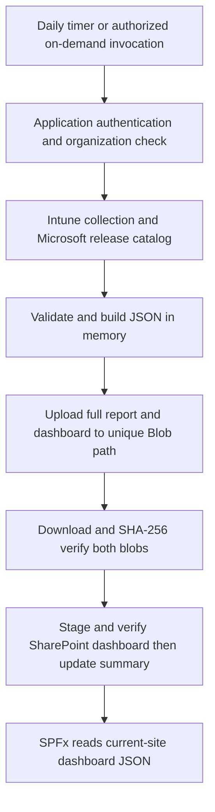

# WISE Client Deployment And Operations

Replace every `<CLIENT_...>` placeholder before use. Validate model availability,
costs, permissions and networking in the target tenant before deployment.
Do not copy test credentials, runtime storage settings, or endpoint data to a client.

## Contents

- [Architecture](#architecture)
- [Client Worksheet](#client-worksheet)
- [Access And Permissions](#access-and-permissions)
- [Manual Entra Setup](#manual-entra-setup)
- [Manual Storage Setup](#manual-storage-setup)
- [Manual SharePoint Setup](#manual-sharepoint-setup)
- [Manual Function Setup](#manual-function-setup)
- [Application Settings](#application-settings)
- [Configuration Versus Code Changes](#configuration-versus-code-changes)
- [Code Deployment](#code-deployment)
- [On-Demand Execution](#on-demand-execution)
- [Acceptance And Monitoring](#acceptance-and-monitoring)
- [Maintenance And Recovery](#maintenance-and-recovery)
- [Troubleshooting](#troubleshooting)
- [Client Handover](#client-handover)

## Architecture

| Destination | Selected authentication | Setting |
| --- | --- | --- |
| Graph: Intune collection and SharePoint publication | Client-owned, single-tenant app registration with application permissions | `WISE_TENANT_ID`, `WISE_CLIENT_ID`, `WISE_CLIENT_SECRET` |
| Blob report archive | Storage account key in a connection string | `WISE_ARCHIVE_CONNECTION_STRING` |
| Function runtime/deployment storage | Azure Function creation wizard configuration | Platform-owned storage settings |
| SPFx dashboard readers | Their normal SharePoint user session and site permissions | No browser secrets |

No Storage Blob Data Contributor assignment to the Function identity is needed
for this account-key archive method. Graph also does not need a managed identity
when `WISE_GRAPH_AUTH=client-credentials`. An existing identity can remain enabled
but is not the chosen credential. Key Vault references, if adopted, need separate
identity/secret-read configuration.



`WiseDailyRefresh` calls `run_hosted_pipeline()` directly, not the CLI. There is
no browser login, subprocess, runtime dependency install or local report JSON.
Azure platform/dependency files still exist on the worker. Blob failure blocks
SharePoint; dashboard and summary updates are not an atomic transaction.

When configured, the Mistral integration sends an allowlisted aggregate projection
to the client-owned model endpoint. It does not send raw device names, user names,
serial numbers or device identifiers. If model generation fails, deterministic
dashboard insights remain available. Client administrators must review model data
processing, access, cost and retention requirements before enabling it.

Optional per-device configuration details can be marked unavailable after sustained
Graph throttling. In that case the report's collection status is partial and the
remaining configuration-detail requests are skipped for that run. Core collection
errors still block publication. Review coverage and monitor repeated throttling;
this safeguard does not guarantee that all future collections succeed.

## Client Worksheet

Record the following in the client's deployment/change record, without secrets:

| Item | Client value |
| --- | --- |
| Directory | Tenant UUID and verified domain |
| Azure | Subscription UUID, resource group, region, approved plan |
| App registration | Display name, application/client UUID, owner and secret expiry |
| Function App | Globally unique resource name and actual Overview hostname |
| Runtime storage | Wizard-selected account and deployment container |
| Archive | Account, private container, prefix and approved retention |
| SharePoint | Canonical site URL, app catalog, page, owners and reader groups |
| Operations | UTC schedule, support owner, alert recipients and rotation owners |

Use separate resources/credentials per client and environment. This is not a
multi-client aggregator. Authenticated organization, source report and SharePoint
ownership must all belong to the same client tenant.

## Access And Permissions

| Actor | Required capability |
| --- | --- |
| Azure deployer | Create/configure resources and deploy Function code at approved scope; commonly Contributor, subject to policy |
| Storage credential administrator | Read account keys and rotate them; policy may separately restrict these actions |
| Entra app owner | Create/manage registration and secret |
| Consent administrator | Grant Microsoft Graph application-role admin consent using an authorized role, such as Privileged Role Administrator or Global Administrator |
| SharePoint administrator | Create site/app catalog and approve/deploy SPFx package |
| Site owner | Provision assets/list/page and manage reader access |
| Dashboard reader | Read page and JSON; no Intune admin role just to view published results |

Azure Contributor is not Graph consent, SharePoint access, or an identity-based
Blob data role. This design instead uses account-key Blob access. Account keys
grant broad account access, not container-only access. Obtain client security
approval for this and the broad Graph SharePoint permission before deployment.

## Manual Entra Setup

1. Switch Entra admin center to the **client directory**.
2. Open **Identity > Applications > App registrations > New registration**.
3. Choose a client-approved display name, for example `WISE Reporting Production`.
4. Select **Accounts in this organizational directory only**. Leave redirect URI
   empty for this unattended workflow, then register.
5. From Overview record **Application (client) ID** and **Directory (tenant) ID**.
   Neither is the application object ID or enterprise service principal object ID.
6. Select **API permissions > Add a permission > Microsoft Graph > Application permissions**.
7. Add the following permissions. An authorized administrator must select
   **Grant admin consent for <client>** and verify Granted status for each.
8. Select **Certificates & secrets > Client secrets > New client secret** and
   choose an approved description/expiry. Record owner and rotation date.
9. Enter the secret **Value** directly into the later Azure setting
   `WISE_CLIENT_SECRET`. The **Secret ID** is not usable for authentication.
   Store the value in the client's approved secret store; it is shown only once.

| Graph application permission | Purpose |
| --- | --- |
| `DeviceManagementManagedDevices.Read.All` | Managed inventory and device evidence |
| `DeviceManagementConfiguration.Read.All` | Compliance, encryption, configuration and update policies |
| `DeviceManagementServiceConfig.Read.All` | Enrollment/Autopilot evidence |
| `Directory.Read.All` | Organization verification before collection |
| `Sites.ReadWrite.All` | Tenant-root/site discovery, SiteAssets publication/readback, summary updates |

These are **application**, not delegated, permissions. The code uses
`ClientSecretCredential` and `https://graph.microsoft.com/.default`, with no
interactive fallback. No localhost/broker redirect or public-client flow is needed.
The older CLI's delegated scopes do not authorize this hosted application.

`Sites.ReadWrite.All` is tenant-wide and needs security approval. The publisher is
not adapted or verified for `Sites.Selected`; changing to it is a separate design
and code change. No Graph device-write role is needed. Intune licensing/API
availability still applies. Do not add older delegated app/user read scopes solely
because they appear in CLI documentation; the current hosted inventory grouping
does not query those APIs.

## Manual Storage Setup

1. In Azure Portal select the client subscription/resource group and create a
   dedicated archive **Storage account**, Standard general-purpose v2.
2. Choose client-approved region/redundancy/tier. Test uses LRS/Hot, not a mandatory
   production choice. Leave hierarchical namespace disabled for the tested setup.
3. Require secure transfer and TLS 1.2 or later; disable anonymous Blob access.
4. Under **Configuration**, enable **Allow storage account key access**. If client
   policy prohibits Shared Key, stop: use an approved identity-based alternative
   after design review, not a policy bypass.
5. Under **Data storage > Containers > + Container**, create `wise-reports` with
   **Private (no anonymous access)**. A different valid container is configurable.
6. Open **Security + networking > Access keys > Show**. Obtain one account
   connection string and enter it directly in `WISE_ARCHIVE_CONNECTION_STRING`.
   Never store it in source, browser code, chat, screenshots or shared command history.
7. Record `https://<CLIENT_ARCHIVE_ACCOUNT>.blob.core.windows.net` as
   `WISE_ARCHIVE_ACCOUNT_URL`. Do not append a container, connection string or SAS.
8. Configure networking to permit Function-to-Blob access. Restricted networks need
   compatible VNet/private endpoint/DNS setup. A key does not bypass firewalls;
   do not assume trusted-services access permits arbitrary Functions.
9. Configure soft delete and client-approved lifecycle retention. For a 90-day
   example, use block blobs filtered to `wise-reports/reports/` and deletion after
   90 days. Do not apply report rules to runtime/deployment containers.

Each archive writes two blobs with `overwrite=False`:

```text
<prefix>/<client-tenant-uuid>/<YYYY>/<MM>/<DD>/<HHMMSS>-<unique-id>/EndpointHealthReport.json
<prefix>/<client-tenant-uuid>/<YYYY>/<MM>/<DD>/<HHMMSS>-<unique-id>/dashboard.json
```

Paths use upload-time UTC; JSON retains collection time. Both documents are read
back and hash-verified before SharePoint. A wrong-account connection string is
rejected, and a failing configured secret has no silent identity fallback.
Runtime does not create containers or delete history. Without lifecycle/manual
deletion history remains indefinitely. Seven-day soft delete is a recovery window
**after deletion**, not automatic deletion of seven-day-old reports.

## Manual SharePoint Setup

After the SharePoint administrator creates the client site, the remaining
repeatable SharePoint setup can be performed by the separate
[Provision-WISESharePointSite.ps1](Provision-WISESharePointSite.ps1) script. It
publishes and installs the approved SPFx package, creates the WISE Site Assets
library if absent, folder and ownership seed, creates/validates the summary list schema and owned row,
and creates/validates the page with the WISE web part. It does not create the site,
Entra registration/consent, or Azure resources. The operator needs permission to
publish tenant apps, manage the target site, and access the SharePoint admin site.
If the tenant has no app catalog, the script can create one with the explicit
`-ProvisionTenantAppCatalog` option plus its URL, owner UPN, and time-zone ID.
Catalog creation is tenant-wide and only runs when no catalog is registered; it
will not replace an existing one. The Python
Function does not run this provisioner; keep it as a separate administrative step.

Build the production SPFx package first. Preview the intended work with
`-WhatIf`, then run again without it after the client administrator approves:

```powershell
.\Provision-WISESharePointSite.ps1 `
   -SiteUrl 'https://<CLIENT_TENANT>.sharepoint.com/sites/<CLIENT_SITE>' `
   -TenantId '<CLIENT_TENANT_UUID>' `
   -PnPClientId '<CLIENT_APPROVED_PNP_APP_ID>' `
   -WhatIf

.\Provision-WISESharePointSite.ps1 `
   -SiteUrl 'https://<CLIENT_TENANT>.sharepoint.com/sites/<CLIENT_SITE>' `
   -TenantId '<CLIENT_TENANT_UUID>' `
   -PnPClientId '<CLIENT_APPROVED_PNP_APP_ID>'
```

If no tenant app catalog is registered, add these parameters to the live command.
Use a dedicated `/sites/...` catalog URL, an owner UPN, and a time-zone ID returned
by `Get-PnPTimeZoneId -Match <region>`:

```powershell
   -ProvisionTenantAppCatalog `
   -TenantAppCatalogUrl 'https://<CLIENT_TENANT>.sharepoint.com/sites/appcatalog' `
   -TenantAppCatalogOwner '<ADMIN_UPN>' `
   -TenantAppCatalogTimeZoneId <ID>
```

Run this in PowerShell 7.4 or newer. On a live run, the script installs
PnP.PowerShell from PSGallery for the current user if it is missing; confirm that
PowerShell Gallery is an approved package source first. A client-approved
interactive PnP application registration is also required. `-WhatIf` does not
install the module or connect to SharePoint. The script leaves the page as a draft. Publish it only after the
site's reader access is reviewed and a first Function refresh has successfully
replaced the seed; use `-PublishPage` only for an explicitly approved early publish.
`-SetHomePage` additionally requires `-PublishPage`. It does not set the Azure
Function app settings; configure `WISE_SITE_URL` to this same canonical URL.

The following details describe what the provisioner creates and the contracts the
Function subsequently verifies. If automation cannot be used, a site owner can
perform these steps manually.

### Site And Web Part

1. In client SharePoint admin center create a communication site, for example
   `https://<CLIENT_SP_TENANT>.sharepoint.com/sites/WISEEndpointIntelligence`.
2. Record its canonical URL, not only its display title. Current validation supports
   public-cloud `https://<tenant>.sharepoint.com/sites/<name>` or `/teams/<name>`.
   Root sites, custom domains, encoded paths, sovereign clouds and multi-geo need review.
3. Configure site owners and intended readers. JSON includes identifiable user/device
   exception data; do not grant organization-wide access without approval.
4. In SharePoint admin center **More features > Apps > Open** / **Manage apps**, upload
   the approved `endpoint-iq.sppkg` to the client app catalog and approve deployment.
5. Add WISE Endpoint Intelligence to the target site's apps if necessary; the current
   package has `skipFeatureDeployment=false`. Create a modern page, add the WISE
   web part, and publish after initial collection. Set homepage only if approved.

SPFx source: [endpoint-iq](../../EndpointIQ-SPFx/endpoint-iq). If rebuilding, use
the Node version required by its package and run `npm ci`, then `npm run build`.
The package output is under `sharepoint/solution/`. The web part uses the current
site's SharePoint session to read JSON, not direct Graph, Blob or Function calls.
No Entra secret, storage key or host key belongs in SPFx or its property bag.

### Required Assets And First-Run Bootstrap

The Function only refreshes existing assets. It does not create sites, lists,
columns, folders, pages or seed files. A site owner must provision these contracts:

| Asset | Exact requirement |
| --- | --- |
| Library | Existing SiteAssets document library, including hidden/system discovery |
| Folder | `SiteAssets/WISEEndpointIntelligence` |
| File | `SiteAssets/WISEEndpointIntelligence/dashboard.json` |
| JSON ownership | Numeric `schemaVersion=2`; `metadata.tenant` equals client tenant UUID |
| Summary list display title | `WISE Endpoint Intelligence Summary` |
| Summary description | Exactly `WISE Endpoint Intelligence source-backed statistics v2` |
| Summary item | Exactly one item, Title `WISE Endpoint Intelligence Report Statistics`, Tenant equals client tenant UUID |

For a new site, create the folder through SiteAssets and upload a restricted UTF-8
`dashboard.json` with the following ownership bootstrap (replace the UUID):

```json
{"schemaVersion":2,"metadata":{"tenant":"<CLIENT_TENANT_UUID>"}}
```

This is **not a populated dashboard**. Keep the page unpublished/restricted until
the first verified collection replaces this seed with the real snapshot. Never
copy a test-tenant report and simply relabel its tenant. A real existing snapshot
from the same client may be used instead.

Create a blank list with the exact title and description above. In **List settings
> Create column**, create the following using exact names **without spaces** so
their internal names match. Friendly display names may be changed later. Use
writable, optional columns without formulas or calculated values:

| Type | Exact internal names |
| --- | --- |
| Existing single-line text | `Title` |
| Single-line text | `CollectionTimestamp`, `ReportTitle`, `Tenant`, `GeneratedBy`, `SourceSha256` |
| Multiple lines of plain text | `SourceSystems`, `SourceSummaryJson` |
| Number, zero decimals, not percentage | `TotalDevices`, `TotalUsers`, `CompliantDevices`, `NonCompliantDevices`, `ConfigManagerDevices`, `EncryptedDevices`, `UnencryptedDevices`, `StaleDevices`, `NonStaleDevices`, `StorageMeasuredDevices`, `CriticalStorageDevices`, `LowStorageDevices`, `AutopilotRegistered`, `InGracePeriod`, `UnknownDevices`, `ThreatDevices`, `UnknownThreatDevices`, `OrphanDevices`, `AutopilotEnrolled`, `AutopilotNotContacted`, `PatchCurrentOrRecent`, `PatchSlightlyBehind`, `PatchVeryOutdated`, `PatchCritical` |

`CollectionTimestamp` must be text, not Date and Time: exact string readback is
verified. Retain writable Title, avoid additional required columns, and create
exactly one item with the required Title and Tenant. Other fields may be blank
initially. Confirm internal names through the column settings URL (`Field=`).
Enable/retain version history under client policy. The runtime discovers GUIDs;
do not copy test list/item/drive IDs or the legacy Function's `SP_LIST_*` settings.

The four `Patch...` fields remain for legacy schema compatibility. They use old
categories, may be zero, and are **not** current monthly-B patch compliance.
Use the dashboard's `windowsPatchSummary` and supported/evaluated denominator.
The separate legacy static statistics HTML is not regenerated by this Function.
Do not present that page as current output. The old five-list setup script is not
the provisioning procedure for this summary list.

## Manual Function Setup

1. Azure Portal > **Create a resource > Function App** in the client subscription.
2. Choose **Flex Consumption**, Linux, Python **3.11**, approved region and resource
   group. Select a globally unique name such as `wise-client-prod` if available.
3. Configure runtime/deployment storage in the creation wizard. Prefer separation
   from the report archive so lifecycle rules/key rotations cannot break runtime.
4. Enable Application Insights with an approved client Log Analytics workspace.
5. Review networking/access restrictions, HTTPS, budget and tags, then create.
6. Record the actual hostname from Overview; new names may include a generated suffix.
7. Open **Settings > Environment variables > App settings** and enter the next table.
8. Keep `AzureWebJobs.WiseDailyRefresh.Disabled=true` during setup/deployment.

Preserve wizard-created runtime/deployment settings, including `AzureWebJobsStorage`,
`DEPLOYMENT_STORAGE_CONNECTION_STRING` when used, and
`APPLICATIONINSIGHTS_CONNECTION_STRING`. Do not copy values from the test app.
On Flex the Python version is configured on the runtime itself; do not blindly
add classic App Service build flags or `WEBSITE_RUN_FROM_PACKAGE` settings.
The shipped host timeout is sixty minutes. Benchmark client fleet size, throttling,
duration and memory before production; the small test fleet is not a scale guarantee.

## Application Settings

Enter each name/value manually with **Add**, then **Apply/Save**. Do not add quote
characters around portal values. Set every WISE value explicitly:

| Setting | Client value | Secret |
| --- | --- | --- |
| `WISE_GRAPH_AUTH` | `client-credentials` | No |
| `WISE_TENANT_ID` | `<CLIENT_TENANT_UUID>` | No |
| `WISE_CLIENT_ID` | `<CLIENT_APPLICATION_CLIENT_UUID>` | No |
| `WISE_CLIENT_SECRET` | Client secret **value**, not Secret ID | Yes |
| `WISE_SITE_URL` | `https://<CLIENT_SP_TENANT>.sharepoint.com/sites/<CLIENT_SITE>` | No |
| `WISE_ARCHIVE_ACCOUNT_URL` | `https://<CLIENT_ARCHIVE_ACCOUNT>.blob.core.windows.net` | No |
| `WISE_ARCHIVE_CONTAINER` | `wise-reports` or approved private container name | No |
| `WISE_ARCHIVE_PREFIX` | `reports` or nonempty approved path segments | No |
| `WISE_ARCHIVE_CONNECTION_STRING` | Connection string for that same archive account | Yes |
| `WISE_REPORT_SCHEDULE` | `0 0 7 * * *` for 07:00 UTC daily | No |
| `WISE_GRAPH_REQUEST_TIMEOUT_SECONDS` | Optional integer 10-300; default 60 seconds per HTTP request | No |
| `AzureWebJobs.WiseDailyRefresh.Disabled` | `true` during setup, `false` when ready | No |
| `MISTRAL_ENDPOINT` | Optional client-owned OpenAI-compatible endpoint ending in `/openai/v1` | No |
| `MISTRAL_DEPLOYMENT` | Optional model deployment name, default `mistral-medium-3-5` | No |
| `MISTRAL_API_KEY` | Client-owned model API key; required when the model is enabled | Yes |

Do not use generic `TENANT_ID`, `CLIENT_ID` or `CLIENT_SECRET` from the legacy
project; this project reads the `WISE_` names. Tenant/client must be canonical
UUIDs. App client ID and secret must belong to the same client registration.
The hosted site and tenant must be explicitly configured. Client-credentials hosted
mode requires explicit tenant, client ID and independent archive connection string.
Mistral is optional; missing or invalid model settings leave deterministic insights
available. Use a client-approved model deployment and data-processing agreement.

Cron has six fields: seconds, minutes, hours, day, month, day-of-week. Flex uses
UTC; region and portal timezone do not alter the schedule. Do not set
`WEBSITE_TIME_ZONE` on Linux Flex/Consumption. For example 07:00 India Standard
Time is `0 30 1 * * *` UTC. DST-aware local schedules need a separate approved design.

## Configuration Versus Code Changes

**A normal public-cloud client deployment needs no runtime source-code change**
when all app settings are supplied and the SharePoint contracts above are kept.

| Change | Location | Source edit needed? |
| --- | --- | --- |
| Client tenant | `WISE_TENANT_ID`, client-owned seed and summary item | No |
| Graph application/client ID and secret | `WISE_CLIENT_ID`, `WISE_CLIENT_SECRET`, client admin consent | No |
| Entra app display name | App registration display name only | No |
| Function App resource name | Azure resource creation and publish command target | No |
| Subscription/resource group/region | Azure resources and deployment authentication/target | No |
| SharePoint domain/site path/title | `WISE_SITE_URL`, manual site/page setup | No |
| Archive account/container/prefix/key | Corresponding `WISE_ARCHIVE_*` settings together | No |
| Schedule | `WISE_REPORT_SCHEDULE` | No |
| Insights workspace/component | Client wizard telemetry configuration | No |
| Page display title/homepage | SharePoint settings | No |
| SPFx solution/web-part GUIDs | Keep stable product identifiers across tenants | No |
| Internal function name `WiseDailyRefresh` | Decorator in `function_app.py`, disabled-setting name, monitoring/runbook | Yes, only if intentionally renamed |
| Dashboard JSON folder/file | Python publisher target/staging paths and SPFx loader | Yes, coordinated backend/frontend change |
| Summary title/description/row title | `SUMMARY_TITLE`, `SUMMARY_MARKER`, `ROW_TITLE`, provisioning and tests | Yes, if changing those contracts |
| Product branding | SPFx component/manifest/package metadata; rebuild package | Yes for UI branding beyond site/page titles |
| Sovereign cloud, custom domains, multi-geo, Sites.Selected, certificate auth | Authority/endpoints/validation/auth and permission design | Yes, separately designed/tested |

This public source release has no tenant, client, site, or archive-account
defaults. Configure them explicitly. Never put secrets into source files.

The frontend reads `${current-site}/SiteAssets/WISEEndpointIntelligence/dashboard.json`,
so changing the site's hostname/path does not require a frontend edit. Preserve
solution/web-part GUIDs unless creating a deliberate product fork. The existing
test-targeted PowerShell deployment/migration scripts have defaults and guards;
do not run them unchanged against a client. Use manual app catalog/page setup.

Optional local CLI use is distinct: `python wise_endpoint_intelligence.py` defaults
to delegated browser authentication even if `WISE_GRAPH_AUTH` is set. Its `--auth`
choices do not expose client credentials. For the selected unattended application
workflow use the hosted Function; do not assume a CLI run tests hosted authentication.

## Code Deployment

Deploy this directory as the project root, **not the workspace** or the legacy
`Data Telemetry/intune_report_function` project. Core deployment files:

- [function_app.py](function_app.py): timer registration.
- [wise_endpoint_intelligence.py](wise_endpoint_intelligence.py): auth/collection/archive/publication.
- [mistral_intelligence.py](mistral_intelligence.py): optional aggregate-only AI narrative.
- [requirements.txt](requirements.txt): remote-build dependencies.
- [host.json](host.json): host logging/timeout/extensions.
- [.funcignore](.funcignore): excludes local environments, reports, settings and tests.

On a deployment workstation install Python 3.11, Azure CLI and current Azure
Functions Core Tools v4. These tools are not an ongoing daily PC dependency.
Do not upload Windows virtual environments into Linux.

Run commands individually. First check cached Azure authentication:

```powershell
az account show
```

Only if necessary, sign into the client tenant:

```powershell
az login --tenant <CLIENT_TENANT_UUID>
```

Select/verify subscription and deploy from the client source location:

```powershell
az account set --subscription <CLIENT_SUBSCRIPTION_UUID>
az account show --query '{subscription:id,tenant:tenantId}' -o json
Set-Location '<CLIENT_SOURCE_ROOT>\Data_Collection_DB\EndpointHealthReport_Python'
func azure functionapp publish <CLIENT_FUNCTION_APP> --python --build remote
```

The [local settings example](local.settings.json.example) contains placeholders.
Create a separate `local.settings.json` only if needed; it is excluded from Git
and upload and is not the Azure configuration source. Use explicit `--python` to
avoid language-detection errors.
Do not use `--publish-local-settings` to overwrite manual client settings.
Inspect `.funcignore`/package contents before shipping: no test data, output or
credentials. Review/pin dependencies through the client's approved build process.
Confirm deployment success, host Running and **Functions > WiseDailyRefresh** indexed.

## On-Demand Execution

1. Verify consent/settings/assets and that no other publisher is active.
2. Set `AzureWebJobs.WiseDailyRefresh.Disabled=false`, Apply/Save. This also enables
   the daily timer; choose acceptance time away from the scheduled window.
3. Open **Functions > WiseDailyRefresh > Code + Test > Test/Run**. Leave input empty
   and select Run (portal variants may show an empty JSON editor).
4. Follow **Monitor/Application Insights** until **Succeeded**, not only acceptance.
5. Do not repeatedly click Run or overlap with scheduled/other manual publication.

Code is read-only in the hosted portal; edit locally and redeploy. If Test/Run is
not exposed for the deployment model, an authorized operator may use the host
administration endpoint with an approved secret-aware HTTP client:

```http
POST https://<ACTUAL_CLIENT_FUNCTION_HOSTNAME>/admin/functions/WiseDailyRefresh
x-functions-key: <HOST_MASTER_KEY>
Content-Type: application/json

{"input":""}
```

This is a protected admin endpoint, **not a public HTTP trigger**. Never embed a
host master key in a URL, frontend, source, chat or shared command history.
HTTP **202 means accepted, not completed**. Portal CORS/access restrictions and
private networking can affect access; do not broadly disable controls to expose it.

Each manual run collects live data and performs real Blob and SharePoint writes.
The 07:00 UTC schedule remains unchanged. Enabling does not promise immediate
execution; startup execution is disabled. Monitored past-due invocations can occur
after recovery. Timer coordination within an app is not a global manual-run lock:
keep one publisher per dashboard. Disabled=true prevents future timer triggers,
not necessarily in-flight work or administrative master-key invocation.

## Acceptance And Monitoring

Open **Application Insights > Logs**, scoped to the client Function's component.
Telemetry can take time to ingest; immediately empty results do not prove failure.

```kusto
traces
| where timestamp > ago(24h)
| where message startswith "WISE"
| project timestamp, message, operation_Id
| order by timestamp desc
```

```kusto
requests
| where timestamp > ago(24h)
| where name contains "WiseDailyRefresh"
| project timestamp, name, success, duration, operation_Id
| order by timestamp desc
```

Workspace-scoped queries may use `AppTraces`/`AppRequests` with `TimeGenerated` and
corresponding column names instead. Restrict diagnostic access; source identifiers
can appear in collection logs. Verify all acceptance checks:

- Correct client organization authenticated with client credentials.
- Collection coverage reviewed: errors block publication; optional unavailability is not zero risk.
- Both JSON blobs under a new client tenant/run path and readback verification passed.
- SharePoint dashboard and summary updated and verified.
- `WISE timer completed successfully` and invocation **Succeeded** recorded.
- Independent archive/dashboard SHA-256 comparison when performing release acceptance.
- Client page loads for intended readers with correct collection timestamp/counts.
- Another controlled run creates separate history rather than overwriting archives.
- First actual daily scheduled invocation observed and signed off separately.

The dashboard execution timestamp is collection completion, not proof of final
publication or timer scheduling. Monthly patch compliance uses supported/evaluated
Windows devices and Microsoft B builds, not all-device prevalence or install failure results.

Manually create alerts via **Monitor > Alerts > Create** and client-owned action
groups: failed invocations, missing daily success after an agreed grace window,
excessive duration, storage growth/availability and budget. Add expiry/rotation
checks for both credentials. No alert rules are provisioned by this repository.

## Maintenance And Recovery

### Graph Secret Rotation

1. Create a replacement secret on the same client app before expiry.
2. Update `WISE_CLIENT_SECRET` directly in Azure, Apply/Save, and run controlled acceptance.
3. Verify full completion before removing the old secret. Record new expiry/owner.

No code deployment is needed for rotation. Replacing the registration also requires
updating client ID, consent and tenant validation. Key Vault references need separately
configured access; do not paste a vault URL where a raw secret value is expected.

### Storage Key Rotation

1. Identify the archive key in use and all consumers of the account.
2. Switch the archive setting to a valid alternate-key connection string and verify.
3. Regenerate the unused/old key after dependency review; update other approved consumers.
4. Do not rotate runtime storage keys without updating their own platform settings.

### Recovery

The pipeline does not fall back to yesterday's local report. Partial archives can
remain. A complete archive alone is not publication success. If dashboard commits
and summary fails, inspect current data, run ID/logs and SharePoint version history,
resolve the cause, then run again. Do not blindly restore/delete while another run
may write. No automatic rollback, whole-run retry decorator, historical dashboard
selector or archive replay UI exists. Individual Graph/Blob retries are bounded.
Redeploying old code does not restore destination state. Retain a known-good code
release and client settings securely; never restore test secrets into production.

## Troubleshooting

### Large-Fleet Readiness Update

The Python resilience changes preserve current dashboard JSON/schema, SharePoint
paths/list contracts, UI layout and metrics. No Azure resource or live setting was
changed as part of this update. Redeploy the code to activate these improvements:

- Packaged Function timeout raised from 10 to 60 minutes in `host.json` (tested
   hosting is Flex Consumption; classic Consumption has a ten-minute maximum).
- Valid server `Retry-After` delays are honored in full rather than shortened to
   120 seconds. Retry budget remains six attempts per eligible request.
- Explicit HTTP 429 responses are retried for summary PATCH and staging DELETE
   too. Uncertain write transport failures and PATCH server errors are not blindly retried.
- Verification downloads retry throttling/transient failures while preserving
   redirect validation and never forwarding Graph tokens to SharePoint redirects.
- Graph request timeout is configurable through the optional setting above;
   default remains 60 seconds. This is a Requests connect/read timeout, not a
   whole-job deadline or a way to increase Microsoft's throttling allowance.
- Blob verification hashes downloaded chunks without a second full-file readall
   allocation. The report, serialized upload bytes and SDK buffers still consume memory.
- An offline synthetic test verifies 50,000 records across 50 pages, including
   a mid-collection throttle, without missing/duplicate IDs. It is not a live fleet benchmark.

After redeploying, perform a controlled small-fleet acceptance run and compare UI,
collection coverage, archive/dashboard hashes, summary and invocation completion.
Only then benchmark representative 10,000/50,000-device workloads, peak memory,
duration, request counts and throttles. Longer invocations can cost more; a host
timeout does not guarantee uninterrupted execution during platform events.

**Remaining limits:** no persisted checkpoints or cross-run lock, no distributed
collection, full Graph page accumulation, per-device enrichment requests, in-memory
report copies/serialization, 50 MiB dashboard application guard, browser-wide JSON
download/filtering and unpaginated Windows build table. No full-inventory view was
added. Do not promise 10,000/50,000-device production compatibility on the basis of
the synthetic paging test or longer timeout. Full-inventory/server-side paging and
resumable collection need a separately tested backend/frontend design. Do not raise
the JSON limit simply to force a huge report through the unchanged page.

| Symptom | Check/action |
| --- | --- |
| Language cannot be determined / Worker None | Correct project directory, local Python declaration, explicit `--python --build remote` |
| Function missing | Entrypoint/dependencies, host startup logs, schedule setting |
| No immediate run | Enabled flag and UTC schedule; perform one acceptance trigger |
| Graph auth failure / 401 | Correct tenant/client, secret **value** and expiry, settings applied |
| Graph 403 | Application permissions/admin consent on client app, Intune licensing/API access |
| Blob 403 | Correct connection string/key, Shared Key enabled, network/firewall access |
| Wrong archive endpoint | Connection string and account URL must match |
| ContainerNotFound | Manually create configured private container |
| Tenant/ownership mismatch | Organization, client bootstrap JSON and summary row must match; never relabel test exports |
| Summary/assets missing | Canonical site, exact folder/file/list description/internal column names and one owned row |
| Summary readback mismatch | Writable types, timestamp is text; investigate partial publication |
| HTTP 412 | Another publisher changed an ETag; investigate overlap |
| Empty telemetry | Correct Insights component, access/filter/time range and ingestion delay |
| Timeout/throttling/memory | Client fleet benchmark, source coverage, API throttling, plan/timeout/collection review |
| Old page data | Correct site JSON timestamp, browser cache, correct page; legacy statistics page is not refreshed |

Hosted errors intentionally suppress sensitive bodies. Use run ID, failed stage,
source status/request IDs and restricted service logs. Do not enable token/body
logging or publish endpoint exports to public diagnostics.

## Client Handover

- [ ] Approvals for broad Graph access, account-key access, report data and retention.
- [ ] Client app registration with five application roles/admin consent; secret owner/expiry.
- [ ] Private archive, matching URL/connection string, separate runtime storage.
- [ ] Client SPFx page/app, owned seed JSON, exact summary schema and one row.
- [ ] Function/Insights created; every WISE setting explicitly configured.
- [ ] Correct client deployment target; no test credentials/data in release package.
- [ ] Manual acceptance and independent destination checks complete.
- [ ] Reader access/data coverage reviewed; first scheduled invocation verified separately.
- [ ] Failure/missing-success alerts, retention, budgets, rotation/recovery owners documented.
